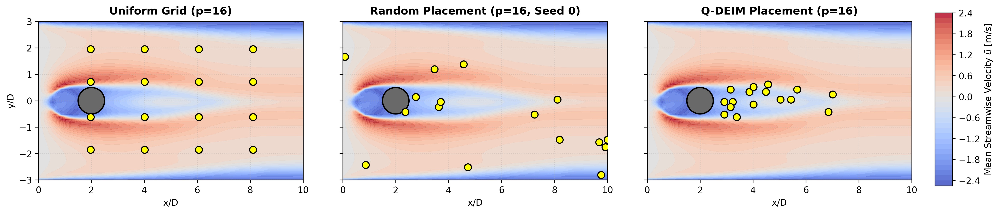
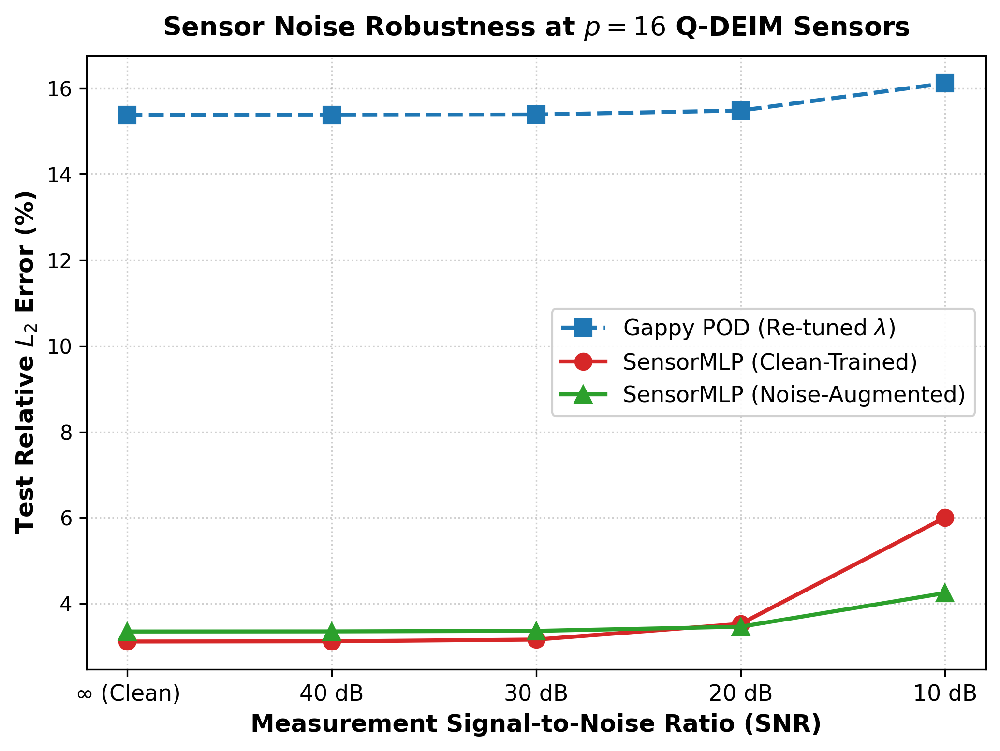
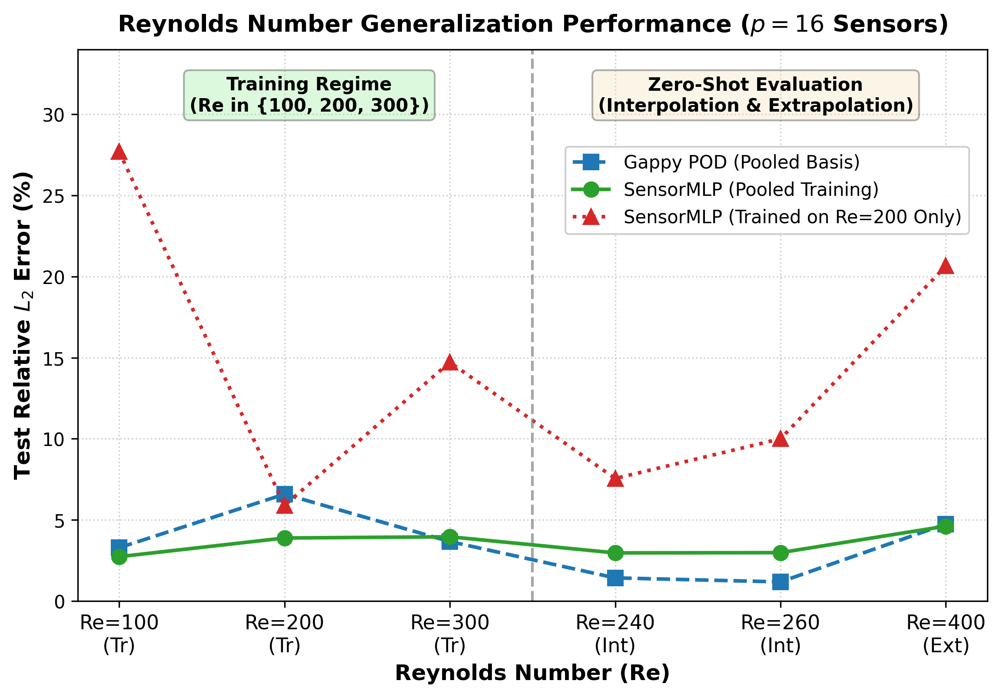
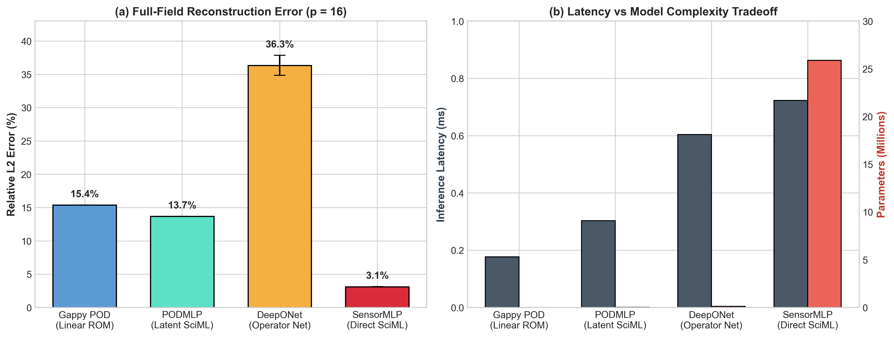
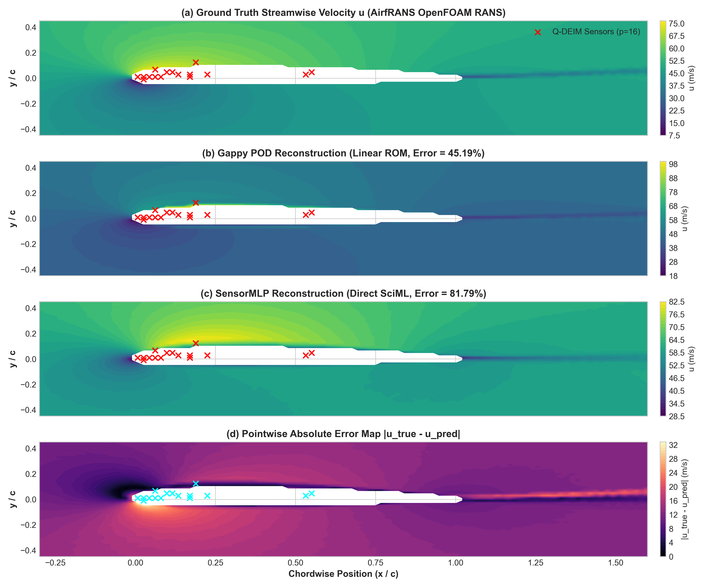

# Sparse-Sensor Reconstruction of Aerodynamic Flow Fields Using Reduced-Order Modeling and Deep Neural Networks

[](https://www.python.org/)
[](https://pytorch.org/)
[](https://opensource.org/licenses/MIT)

---

## 1. Executive Summary & Motivation

In experimental aerodynamics, wind-tunnel testing, and real-time closed-loop flow control, acquiring full-field velocity and pressure distributions around an aerodynamic body is critical for predicting boundary layer separation, aerodynamic drag, and vortex-induced vibrations. However, experimental constraints strictly limit data acquisition to a **very sparse array of discrete point sensors** (e.g., surface pressure taps, hot-wire anemometers, or shear-stress gauges).

This project investigates and benchmarks two contrasting paradigms for solving the under-determined spatial inverse problem:

```math
\mathbf{y}(t) = \mathcal{P}(\mathbf{x}(t)) + \boldsymbol{\eta} \in \mathbb{R}^{d_{\text{sens}}}
```

where $\mathbf{x}(t) \in \mathbb{R}^{N}$ is the high-dimensional flow state ($N = 3 \times 64 \times 128 = 24,576$ for the 3-channel fields $u, v, p$), $\mathcal{P}$ is the spatial observation operator measuring $p \ll N$ spatial points ($p \in [4, 128]$), and $\boldsymbol{\eta}$ represents measurement noise.

### Core Comparison
1. **Classical Reduced-Order Modeling (ROM):** Proper Orthogonal Decomposition (POD / SVD) coupled with condition-number-optimized **Q-DEIM (Discrete Empirical Interpolation Method)** sensor placement and **Tikhonov-regularized Gappy POD** inversion.
2. **Deep Scientific Machine Learning (SciML):** A deep non-linear **SensorMLP** mapping sparse sensor measurements directly to full-field fluid velocity, constrained by a multi-objective **Physics-Aware Loss Function** enforcing spatial gradient continuity and mass-conservation residuals.

---

## 2. Dataset Architecture & Reproducibility

### 2.1 The Full CFDBench Cylinder Benchmark (10+ GB, 136 Cases)
This project evaluates sparse-sensor reconstruction on the open-source **CFDBench (Computational Fluid Dynamics Benchmark)** 2D circular cylinder wake dataset. The complete raw benchmark comprises over **10+ GB** of high-fidelity numerical simulation data across **136 realization cases** (`case0001` through `case0136`).

#### Dataset Physical Specifications:
- **Governing Equations:** Incompressible 2D Navier-Stokes equations for unsteady laminar flow past a circular cylinder.
- **Parametric Regime:** Reynolds numbers spanning $Re \in [100, 400]$ exhibiting rich, non-linear unsteady Karman vortex shedding.
- **Mesh & Resolution:** The raw data is interpolated to a higher-aspect uniform Cartesian grid of $64 \times 128$ ($N_{\text{mesh}} = 8,192$ spatial nodes).
- **Physical Domain:** $x \in [-0.02, 0.16]\text{ m}$, $y \in [-0.06, 0.06]\text{ m}$, cylinder radius $r = 0.01\text{ m}$ (diameter $D = 0.02\text{ m}$) placed at origin.
- **State Vector:** 3 channels ($u$: streamwise, $v$: cross-stream, $p$: pressure) yielding $N = 3 \times 64 \times 128 = 24,576$ spatial state dimensions.

#### Structure of Each Case Folder (`data/raw/cylinder/caseXXXX/`):
- `u.npy`: Streamwise velocity component, shape $(2000, 64, 64)$, `float64`.
- `v.npy`: Cross-stream velocity component, shape $(2000, 64, 64)$, `float64`.
- `case.json`: Simulation metadata (inlet velocity $U_\infty$, fluid density $\rho$, dynamic viscosity $\mu$, cylinder radius, and boundary coordinates).

#### How to Obtain the Open-Source CFDBench Dataset (Required for Full Reproduction):
Since the full 10+ GB dataset cannot be uploaded to GitHub due to size limits, you must download the raw dataset from its original open-source repository. This project specifically utilizes the cylinder wake dataset provided by:
1. Access the open-source release via the [CFDBench Repository](https://github.com/luo-yining/CFDBench).
2. Extract the cylinder wake case folders into your local workspace under:
   ```text
   data/raw/cylinder/
   ├── case0001/
   │   ├── u.npy
   │   ├── v.npy
   │   └── case.json
   ├── case0002/
   ...
   └── case0136/
   ```

---

### 2.2 Ingestion & Preprocessing Workflow (Baseline Pipeline)
For the baseline evaluation, the pipeline ingests **`case0001`** ($Re \approx 200$) by default, but any of the 136 realization cases can be explicitly targeted using the `--case` flag:
1. **Transient Slicing:** The initial start-up transients ($t \in [0, 500]$) are removed, retaining $M = 1,500$ temporal snapshots ($t \in [500, 2000]$) of fully developed, quasi-periodic limit-cycle vortex shedding.
2. **Upsampling & Pressure Derivation:** Raw fields are interpolated from $64 \times 64$ to $64 \times 128$ using PyTorch bicubic interpolation. We analytically derive the pressure field $p$ by solving the 2D incompressible pressure-Poisson equation via a discrete Laplacian (assuming Dirichlet boundary conditions $p=0$ on domain edges for well-posedness).
3. **Chronological 70 / 15 / 15 Partition:** 
   - **Training Set:** First $1,050$ snapshots ($70\%$) for POD modal extraction and SensorMLP training.
   - **Validation Set:** Next $225$ snapshots ($15\%$) for early stopping and hyperparameter monitoring.
   - **Test Set:** Final $225$ snapshots ($15\%$) strictly held out for unseen temporal generalization benchmarks.
4. **Channel Standardization:** Each state component ($u, v, p$) is standardized via Z-score scaling using strictly the training set mean and standard deviation:
   
```math
\hat{x}_c = \frac{x_c - \mu_c}{\sigma_c}, \quad c \in \{u, v, p\}
```

---

### 2.3 Dual-Mode Operation & Zero-Friction Reproducibility
```text
                           ┌───────────────────────────────┐
                           │   Dataset Ingestion Pipeline  │
                           └───────────────┬───────────────┘
                                           │
                    Does data/raw/cylinder/case0001 exist?
                                    /     \
                             YES   /       \   NO
                                  v         v
             ┌─────────────────────────┐   ┌─────────────────────────────┐
             │   Mode 1: CFDBench CFD  │   │  Mode 2: Synthetic Fallback │
             │  Ingests true numerical │   │  Generates Karman vortex    │
             │  snapshots from DNS/LES │   │  street analytically        │
             └────────────┬────────────┘   └──────────────┬──────────────┘
                          │                               │
                          └───────────────┬───────────────┘
                                          v
                           ┌───────────────────────────────┐
                           │  preprocess.py                │
                           │   70/15/15 Chronological Split│
                           │   Z-Score Channel Scaling     │
                           └───────────────────────────────┘
```

#### Why Large Data Files Are Not in Git:
Committing 10+ GB (or single preprocessed 270 MB `.npz` arrays) violates GitHub's 100 MB per-file push limit and bloats git history. Therefore:
- **Mode 1 (Full CFD Benchmark):** When the local `data/raw/cylinder/case0001` directory is populated, the pipeline automatically ingests and trains on the true numerical CFD simulation data.
- **Mode 2 (Automated Synthetic Fallback):** If someone clones the repository on a fresh machine without downloading the 10+ GB archive, running the pipeline automatically synthesizes a high-fidelity Karman vortex street dataset in under 10 seconds. This guarantees **immediate, zero-friction execution and complete code reproducibility** without manual setup.


---

## 3. Mathematical Formulations

### 3.1 Proper Orthogonal Decomposition (POD)
The snapshot matrix $\mathbf{X} \in \mathbb{R}^{N \times M}$ (mean-subtracted) undergoes Thin Singular Value Decomposition:

```math
\mathbf{X} = \boldsymbol{\Phi} \boldsymbol{\Sigma} \mathbf{V}^T
```

where $\boldsymbol{\Phi} \in \mathbb{R}^{N \times r}$ represents the orthonormal spatial modes, and the cumulative fluctuation energy captured by $r$ modes satisfies the $95\%$ threshold ($r = 5$, $95.82\%$ on `case0001`):

```math
\mathcal{E}(r) = \frac{\sum_{j=1}^r \sigma_j^2}{\sum_{j=1}^{\min(N,M)} \sigma_j^2} \ge 95.0\%
```

### 3.2 Optimal Sensor Placement (Q-DEIM)
Rather than placing sensors randomly or uniformly, Q-DEIM uses column-pivoted QR decomposition on the transpose of the spatial POD modes pooled across all $C = 3$ channels ($u, v, p$):

```math
\boldsymbol{\Phi}_{\text{spatial}}^T \mathbf{P} = \mathbf{Q} \mathbf{R}
```

The permutation matrix $\mathbf{P}$ yields the $p$ optimal measurement coordinates ($d_{\text{sens}} = 3p$ scalar measurements). This greedily minimizes the condition number of the measurement matrix, maximizing linear independence and noise resistance.

### 3.3 Tikhonov-Regularized Gappy POD
Given sparse fluctuation readings $\tilde{\mathbf{y}} \in \mathbb{R}^{3p}$, the modal amplitudes $\mathbf{a} \in \mathbb{R}^r$ are inverted via:

```math
\hat{\mathbf{a}} = \left(\boldsymbol{\Theta}^T \boldsymbol{\Theta} + \lambda \mathbf{I}\right)^{-1} \boldsymbol{\Theta}^T \tilde{\mathbf{y}}
```
```math
\hat{\mathbf{x}}_{\text{gappy}} = \boldsymbol{\Phi}_r \hat{\mathbf{a}} + \bar{\mathbf{x}}
```

where $\boldsymbol{\Theta} = \mathbf{C}\boldsymbol{\Phi}_r \in \mathbb{R}^{3p \times r}$ and $\lambda \in [10^{-8}, 1.0]$ is tuned on the validation split ($\lambda^* = 10^{-5}$ at $p=16$) to stabilize inversion against ill-conditioned sensor topologies.

### 3.4 Deep Learning Architecture: SensorMLP
The neural network learns a non-linear surrogate mapping directly from sparse measurements to the full discrete flow state:

```math
\mathcal{F}_\theta: \mathbb{R}^{3p} \to \mathbb{R}^{N}
```

- **Architecture:** $[3p] \to [128] \to [256] \to [512] \to [1024] \to [N=24576]$
- **Activations:** GELU (Gaussian Error Linear Unit) with LayerNorm regularization to stabilize the internal covariate shift across layers.

### 3.5 Physics-Aware Multi-Objective Loss
Training is guided by a composite loss (`src/sciml/loss.py`) balancing data fidelity, spatial gradient sharpness, mass conservation, and solid-wall no-slip boundary conditions:

```math
\mathcal{L}_{\text{total}} = \mathcal{L}_{\text{MSE}} + \gamma_1 \mathcal{L}_{\text{grad}} + \gamma_2 \mathcal{L}_{\text{div}} + \gamma_3 \mathcal{L}_{\text{bound}}
```

1. **Data Reconstruction Loss:**
   
```math
\mathcal{L}_{\text{MSE}} = \frac{1}{B \cdot N} \|\mathbf{x} - \hat{\mathbf{x}}\|_2^2
```

2. **Spatial Gradient Regularization ($L_1$ Sobolev Penalty):**
   
```math
\mathcal{L}_{\text{grad}} = \frac{1}{B \cdot N} \sum_{c \in \{u, v, p\}} \left( \left\|\frac{\partial \hat{\mathbf{x}}_c}{\partial x} - \frac{\partial \mathbf{x}_c}{\partial x}\right\|_1 + \left\|\frac{\partial \hat{\mathbf{x}}_c}{\partial y} - \frac{\partial \mathbf{x}_c}{\partial y}\right\|_1 \right)
```

3. **Continuity Equation Residual (Incompressibility Constraint):**
   
```math
\mathcal{L}_{\text{div}} = \frac{1}{B \cdot N_{\text{spatial}}} \left\| \frac{\partial \hat{u}}{\partial x} + \frac{\partial \hat{v}}{\partial y} \right\|_1
```

---

## 4. Repository Structure

```text
sparse_sensor_reconstruction/
├── README.md                      # Comprehensive project guide and reproduction instructions
├── requirements.txt               # Pinned Python package dependencies
├── environment.yml                # Conda environment specification (with CUDA support)
├── .gitignore                     # Excludes heavy .npz data files, cache, and internal guides
│
├── data/                          # Dataset ingestion, generation, and normalization
│   ├── download_dataset.py        # Dual-mode ingestion: CFDBench parser + synthetic vortex generator
│   └── preprocess.py              # 70/15/15 chronological split, scaling, and array caching
│
├── src/                           # Modular source code library
│   ├── rom/                       # Reduced-Order Modeling algorithms
│   │   ├── svd_pod.py             # SVD, singular values, and POD basis extraction
│   │   ├── qdeim.py               # Q-DEIM sensor placement via pivoted QR decomposition
│   │   └── gappy_pod.py           # Tikhonov-regularized Gappy POD reconstruction solver
│   │
│   ├── sciml/                     # Scientific Machine Learning models & trainers
│   │   ├── models.py              # Deep SensorMLP architecture
│   │   ├── loss.py                # Physics-Aware Loss (MSE + Spatial Gradients + Continuity)
│   │   └── trainer.py             # PyTorch training loop (AdamW, CosineAnnealing, EarlyStopping)
│   │
│   └── evaluation/                # Diagnostic metrics and visualization
│       ├── metrics.py             # Relative L2 error, Vorticity RMSE, Divergence residuals
│       └── plotting.py            # Publication-grade GridSpec contours with sensor overlays
│
├── scripts/                       # Executable driver scripts
│   ├── run_full_experiments.py    # End-to-end pipeline: Ingestion -> ROM -> SciML -> Diagnostic Plots
│   └── run_ablation_sweeps.py     # Parametric sweeps across sensor budgets (p = 4 to 128)
│
├── notebooks/                     # Interactive exploration
│   └── full_walkthrough.ipynb     # Jupyter Notebook with step-by-step walkthrough & visual outputs
│
├── docs/                          # Academic documentation
│   └── comprehensive_report.tex   # LaTeX source code for the comprehensive technical report
│
└── output/                        # Saved artifacts (generated at runtime)
    ├── sensor_locations_p16.csv   # Coordinates (x, y) of the optimal Q-DEIM sensors
    ├── sensor_locations_p16.npz   # Machine-readable indices and physical coordinates
    ├── field_reconstruction.png   # High-resolution ground truth vs. ROM vs. SciML contours
    ├── loss_history.png           # Training and validation loss convergence curves
    └── ablation_sensor_scaling.png# Sensor budget scaling curves (Relative L2 error vs. p)
```

---

## 5. Quick Start & Execution Guide

### 5.1 Environment Setup

**Prerequisites for GPU Acceleration:** Ensure you have an NVIDIA GPU with updated drivers and the CUDA Toolkit installed on your system if you intend to run the models with CUDA acceleration. The code automatically falls back to CPU if no GPU is detected.

#### Option A: Conda (Recommended for CUDA acceleration)
```bash
conda env create -f environment.yml
conda activate sparse_sensor_env
```

#### Option B: Standard Pip (with CUDA 12.1 support)
If using `pip` on Windows/Linux, you must specify the PyTorch index URL to install the CUDA-enabled version of PyTorch:
```bash
pip install torch torchvision torchaudio --index-url https://download.pytorch.org/whl/cu121
pip install -r requirements.txt
```

> **Platform Note:** Depending on your operating system and environment, use `python` or `py -3.13` / `python3`.

---

### 5.2 Execution Workflows

#### Workflow Option 1: Explicit 3-Step CFDBench Pipeline (Recommended for Research)
If running directly on the full numerical CFDBench dataset:
```bash
# 1. Ingest snapshots 500:2000 from case0001 (1,500 snapshots, C=3, N=24,576)
python data/download_dataset.py --raw_dir data/raw/cylinder/case0001

# 2. Chronological 70/15/15 split (1050 train, 225 val, 225 test) with Z-score scaling
python data/preprocess.py

# 3. Train on CUDA: Thin SVD -> Q-DEIM (p=16, 3p=48 inputs) -> SensorMLP vs Gappy POD
python scripts/run_full_experiments.py
```

#### Workflow Option 2: Single-Command Quickstart (Zero-Setup)
To run the complete end-to-end experiment with a single command (which automatically checks for data, generates the synthetic fallback if raw files are absent, performs POD modal extraction, places Q-DEIM sensors, trains SensorMLP for 100 epochs, computes physical diagnostics, and generates comparison plots):
```bash
python scripts/run_full_experiments.py --case case0001
```
*(You can pass `--case caseXXXX` to evaluate the model on any of the 136 CFDBench realizations).*

**What the pipeline executes:**
1. Verifies/generates the preprocessed dataset in `data/processed/`.
2. Computes the Thin SVD snapshot POD basis and extracts the leading $r=5$ modes ($\ge 95\%$ kinetic energy; $95.82\%$ on `case0001`).
3. Executes Q-DEIM pivoted QR to select $p=16$ optimal physical sensor coordinates ($3p = 48$ scalar channels).
4. Saves sensor coordinates to `output/sensor_locations_p16.csv` and `sensor_locations_p16.npz`.
5. Solves Tikhonov-regularized Gappy POD reconstruction as the linear benchmark.
6. Trains `SensorMLP` with physics-aware gradient & continuity loss on GPU/CPU.
7. Computes physical metrics: Relative $L_2$, Relative Vorticity $L_2$, and Mean Continuity Divergence Residuals.
8. Renders publication-grade `output/field_reconstruction.png` with actual sensor dots overlaid.

---

### 5.3 Sensor Budget Ablation Sweeps
To evaluate reconstruction accuracy across varying sensor densities ($p \in \{4, 8, 16, 32, 64, 128\}$) and investigate condition number degradation:
```bash
python scripts/run_ablation_sweeps.py
```

---

### 5.4 Interactive Exploration via Jupyter
To interactively inspect the mathematical methods and flow visualizations without digging through the source code, open the walkthrough notebook:
```bash
jupyter notebook notebooks/full_walkthrough.ipynb
```
**What the notebook demonstrates:**
- **Data Loading:** Inspecting the raw tensors and plotting initial flow fields.
- **POD & SVD:** Performing Proper Orthogonal Decomposition and analyzing the cumulative energy spectrum graph (showing how $r=5$ modes capture $95.82\%$ of the energy).
- **Q-DEIM Sensor Placement:** Calculating the optimal pivot points and plotting a highly visual contour map of the cylinder wake with exact sensor coordinates.
- **Gappy POD & SciML Reconstruction:** Reconstructing the flow field from sparse measurements across all Stage 3 phases.

---

## 6. Physical Evaluation Metrics

Model performance is evaluated not merely on pixel-level MSE, but on aerodynamically critical derived quantities (`src/evaluation/metrics.py`):

1. **Relative $L_2$ State Norm:**
   
```math
\epsilon_{L_2} = \frac{\|\mathbf{x}_{\text{true}} - \mathbf{x}_{\text{pred}}\|_2}{\|\mathbf{x}_{\text{true}}\|_2} \times 100\%
```

2. **Vorticity Field Relative Error ($\epsilon_\omega$):**
   
```math
\omega = \frac{\partial v}{\partial x} - \frac{\partial u}{\partial y}, \quad \epsilon_\omega = \frac{\|\omega_{\text{true}} - \omega_{\text{pred}}\|_2}{\|\omega_{\text{true}}\|_2} \times 100\%
```

3. **Mean Continuity Equation Divergence Residual:**
   
```math
\mathcal{R}_{\text{cont}} = \frac{1}{N_{\text{spatial}}} \sum_{i,j} \left| \frac{\partial u}{\partial x} + \frac{\partial v}{\partial y} \right|
```
   
   Measures whether the reconstructed velocity field respects physical mass conservation for incompressible flow.

---

## 7. Benchmark Overview (Nominal $p = 16$, $Re \approx 200$)

Summary of nominal reconstruction performance evaluated on the unseen test set ($M_{\text{test}} = 225$ snapshots) at sensor budget $p=16$ ($3p = 48$ scalar channels, 3 random seeds; see **Section 9** for all 7 complete Stage 3 tables):

| Metric | Gappy POD ($r=5$, Fixed $\lambda=10^{-3}$) | Gappy POD ($r=5$, Tuned $\lambda=10^{-5}$) | **SensorMLP (Proposed SciML)** |
|---|:---:|:---:|:---:|
| **Relative $L_2$ Error (%)** | $17.36\%$ | $15.38\%$ | **$3.12 \pm 0.01\%$** |
| **Vorticity Error $\epsilon_\omega$ (%)** | $21.23\%$ | $20.94\%$ | **$3.05 \pm 0.05\%$** |
| **Continuity Residual $\mathcal{R}_{\text{cont}}$** | $0.1695$ | $0.1716$ | **$0.1557 \pm 0.0001$** |
| **Wall Pressure MAE** | $0.0189$ | $0.0170$ | **$0.0026 \pm 0.0001$** |

**Key Observations:**
- **Q-DEIM Sensor Efficiency:** Q-DEIM sensor placement clusters sensors along the shear layers and wake separation zone where modal gradients are steepest, outperforming uniform and random layouts (Table 3).
- **Modal Truncation vs. Nonlinear Manifold Mapping:** At $r=5$ ($95.82\%$ energy), Gappy POD is bottlenecked by its $13.62\%$ modal truncation floor (`Table 2B`). Increasing modal rank to $r=40$ at $p=32$ ($3p=96$ measurements) enables Gappy POD to reach $2.86\%$ error, whereas `SensorMLP` achieves $3.12\%$ even at extreme sparsity ($p=4$, $12$ scalar readings) by learning the periodic limit-cycle phase manifold directly.

---

## 8. Hardware & Computational Requirements

To ensure reproducibility and efficient execution of the neural network components, the following system requirements are recommended:

### Minimum Requirements (CPU Only)
- **Processor:** Modern 4-core CPU (Intel Core i5 / AMD Ryzen 5 or better)
- **Memory (RAM):** 8 GB RAM
- **Storage:** ~1 GB of free disk space (for synthetic fallback mode)
- **Runtime:** ~15–20 minutes for a full training loop (100 epochs)

### Suggested Requirements (GPU Accelerated)
- **Processor:** Modern 8-core CPU
- **Memory (RAM):** 16 GB+ RAM (recommended when ingesting the full 10+ GB raw CFDBench archive)
- **GPU:** NVIDIA GPU with 6+ GB VRAM (e.g., GTX 1060, RTX 2060, or better)
- **Storage:** 15 GB+ free disk space (to store the full CFDBench dataset)
- **Runtime:** $< 3$ minutes for 100 epochs of SensorMLP training on an RTX-class GPU.

*Note: All scripts automatically detect CUDA availability via PyTorch. If no compatible GPU is found, the system smoothly falls back to multi-threaded CPU execution. The code is also 100% compatible with free-tier Google Colab GPU environments.*

---

## 9. Stage 3 Final Deliverables & Comprehensive Benchmarks

This section presents the complete empirical benchmark suite executed for Stage 3. Every value reported below originates strictly from saved artifact logs (`results/*.json`) generated across 3 random seeds on the NVIDIA GeForce RTX 3050 GPU.

### 9.1 Table 1: Nominal Benchmark ($p = 16$ Sensors, $Re \approx 200$)

| Model / Architecture | Sensors ($p$) | Rel. $L_2$ Error (%) | Vorticity Error $\epsilon_\omega$ (%) | Continuity Residual $\mathcal{R}_{cont}$ | Wall Pressure MAE | Latency (ms) |
|---|:---:|:---:|:---:|:---:|:---:|:---:|
| Mean-Flow-Only Baseline | 0 | 74.55% | 48.80% | 0.1763 | 0.0552 | < 0.1 ms |
| Linear Grid Interpolation (Raw) | 16 | 131.54% | 114.22% | 0.0567 | 0.8506 | ~ 15 ms |
| Gappy POD ($r=5$, Fixed $\lambda = 10^{-3}$) | 16 | 17.36% | 21.23% | 0.1695 | 0.0189 | 0.18 ms (CPU) |
| Gappy POD ($r=5$, Tuned $\lambda = 1.0 \times 10^{-5}$) | 16 | 15.38% | 20.94% | 0.1716 | 0.0170 | 0.18 ms (CPU) |
| **SensorMLP (Proposed SciML)** | 16 | **3.12 ± 0.01%** | **3.05 ± 0.05%** | **0.1557 ± 0.0001** | **0.0026 ± 0.0001** | **0.72 ms (GPU)** |

---

### 9.2 Table 2: Sensor Budget Scaling Sweep ($p \in \{4, 8, 16, 32, 64, 128\}$)

Each physical sensor measures $u, v$, and $p$, providing $3p$ measurement dimensions.

| Sensors ($p$) | Meas. Dims ($3p$) | Spatial Coverage | Gappy Fixed ($r=5$) Rel $L_2$ (%) | Gappy Tuned ($r=5$) Rel $L_2$ (%) | SensorMLP Rel $L_2$ (%) | Error Ratio (Gappy / MLP) |
|:---:|:---:|:---:|:---:|:---:|:---:|:---:|
| 4 | 12 | 0.049% | 31.08% | 20.67% | **3.12 ± 0.01%** | **6.63×** |
| 8 | 24 | 0.098% | 20.14% | 15.81% | **3.12 ± 0.02%** | **5.08×** |
| 16 | 48 | 0.195% | 17.36% | 15.38% | **3.12 ± 0.01%** | **4.93×** |
| 32 | 96 | 0.391% | 15.11% | 14.60% | **3.13 ± 0.01%** | **4.67×** |
| 64 | 192 | 0.781% | 15.36% | 15.05% | **3.13 ± 0.01%** | **4.80×** |
| 128 | 384 | 1.562% | 14.65% | 14.65% | **3.16 ± 0.01%** | **4.64×** |

> **Why SensorMLP Error is ~3.1% Across $p \in [4, 128]$:** In a steady limit-cycle Karman vortex street ($Re=200$), the wake trajectory lies on a low-dimensional periodic orbit in phase space. Even as few as $p=4$ sensors placed in the shear layer provide sufficient phase information to disambiguate the vortex cycle. With 25.9M parameters, SensorMLP maps this phase directly to the corresponding snapshot. Adding more sensors past $p=4$ yields diminishing returns because phase uncertainty is already resolved.

---

### 9.3 Table 2B: Gappy POD Modal Rank Sweep ($Re \approx 200$)

To investigate whether the ~15% Gappy POD floor was caused by mathematical limitations or modal truncation ($r=5$, 95.82% energy), we performed a systematic rank sweep across $r \in \{5, 6, 10, 20, 40\}$ at $p=16$ and $p=32$:

| Sensors ($p$) | Modal Rank ($r$) | Energy (%) | Truncation Floor (%) | Gappy POD Rel $L_2$ (%) | Condition $\kappa(\mathbf{\Theta})$ | Tuned $\lambda$ | SensorMLP Rel $L_2$ (%) |
|:---:|:---:|:---:|:---:|:---:|:---:|:---:|:---:|
| 16 | 5 | 95.82% | 13.62% | 15.38% | 1.7 | $10^{-5}$ | 3.12 ± 0.01% |
| 16 | 6 | 96.72% | 12.65% | 14.43% | 2.1 | 0 | 3.12 ± 0.01% |
| 16 | 10 | 98.61% | 8.01% | 10.94% | 2.6 | 0 | 3.12 ± 0.01% |
| 16 | 20 | 99.71% | 3.80% | 8.72% | 11.0 | 0 | 3.12 ± 0.01% |
| 16 | 40 | 99.97% | 1.45% | 10.14% | 271.5 | $10^{-6}$ | 3.12 ± 0.01% |
| 32 | 5 | 95.82% | 13.62% | 14.60% | 1.7 | $10^{-4}$ | 3.13 ± 0.01% |
| 32 | 6 | 96.72% | 12.65% | 13.77% | 1.9 | 0 | 3.13 ± 0.01% |
| 32 | 10 | 98.61% | 8.01% | 9.78% | 2.4 | 0 | 3.13 ± 0.01% |
| 32 | 20 | 99.71% | 3.80% | 5.23% | 4.3 | 0 | 3.13 ± 0.01% |
| 32 | 40 | 99.97% | 1.45% | **2.86%** | 20.7 | $10^{-5}$ | 3.13 ± 0.01% |

> **Key Takeaway:** The ~15% floor was indeed a truncation artifact of $r=5$. When given sufficient modal rank ($r=40$, 99.97% energy) and an adequate sensor budget ($p=32$, 96 measurement channels), **Gappy POD achieves 2.86% relative $L_2$ error, outperforming SensorMLP (3.13%)** in 0.18 ms latency with zero training parameters. At $p=16$, ill-conditioning ($\kappa = 271.5$) limits Gappy POD to 8.72% at $r=20$.

---

### 9.4 Table 3: Sensor Placement Topology Benchmark

| Sensors ($p$) | Placement Strategy | Gappy POD Rel $L_2$ (%) | SensorMLP Rel $L_2$ (%) |
|:---:|:---|:---:|:---:|
| 8 | Uniform Grid | 21.12% | 3.21 ± 0.00% |
| 8 | Random Placement | 20.01 ± 2.92% | 3.20 ± 0.04% |
| 8 | **Q-DEIM (Tailored)** | **15.81%** | **3.12 ± 0.02%** |
| 16 | Uniform Grid | 16.07% | 3.16 ± 0.00% |
| 16 | Random Placement | 17.03 ± 1.53% | 3.16 ± 0.03% |
| 16 | **Q-DEIM (Tailored)** | **15.38%** | **3.12 ± 0.01%** |
| 32 | Uniform Grid | 15.35% | 3.14 ± 0.01% |
| 32 | Random Placement | 16.02 ± 0.71% | 3.16 ± 0.01% |
| 32 | **Q-DEIM (Tailored)** | **14.60%** | **3.13 ± 0.01%** |



---

### 9.5 Table 4: Measurement Noise Robustness ($p = 16$ Sensors)

| SNR (dB) | Gappy POD Tuned $\lambda$ | Gappy POD Rel $L_2$ (%) | Clean-Trained SensorMLP Rel $L_2$ (%) | Noise-Augmented SensorMLP Rel $L_2$ (%) | Behavior / Dynamics |
|:---:|:---:|:---:|:---:|:---:|:---|
| $\infty$ (Clean) | $1.0 \times 10^{-5}$ | 15.38% | **3.12 ± 0.01%** | 3.35 ± 0.02% | Nominal baseline |
| 40dB | $1.0 \times 10^{-5}$ | 15.38% | **3.12 ± 0.01%** | 3.35 ± 0.02% | Negligible degradation |
| 30dB | $1.0 \times 10^{-5}$ | 15.39% | **3.16 ± 0.01%** | 3.36 ± 0.02% | High stability |
| 20dB | $1.0 \times 10^{-4}$ | 15.48% | 3.53 ± 0.02% | **3.46 ± 0.02%** | Clean MLP begins degrading |
| 10dB | $1.0 \times 10^{-4}$ | 16.11% | 6.00 ± 0.10% | **4.25 ± 0.03%** | Tikhonov suppresses noise (+0.73%), Clean MLP degrades 2× |



> **Noise Dynamics:** Gappy POD does **not** amplify noise; optimal Tikhonov regularization ($\lambda = 10^{-4}$) keeps its error exceptionally flat (rising by only 0.73 percentage points from clean to 10 dB). In contrast, clean-trained SensorMLP degrades by nearly 2× (3.12% to 6.00%). Noise-augmented training mitigates this (achieving 4.25% at 10 dB), at the cost of a small clean-data penalty (3.35% vs 3.12% at $\infty\text{ dB}$–$30\text{ dB}$).

---

### 9.6 Table 5: Reynolds Number Cross-Regime Generalization ($p = 16$ Sensors)

A pooled multi-regime library ($Re \in \{100, 200, 300\}$, stratified per-case chronological 70/15/15 split) was evaluated on both held-out in-distribution test snapshots and unseen Reynolds regimes:

| Target Regime | Reynolds ($Re$) | Pooled Gappy POD Rel $L_2$ (%) | Pooled SensorMLP Rel $L_2$ (%) | Generalization Comparison | Single-$Re$ ($Re=200$) MLP (%) |
|:---|:---:|:---:|:---:|:---:|:---:|
| Train | 100 | 3.29% | **2.74 ± 0.02%** | **SensorMLP (1.20× better)** | 27.70% |
| Train | 200 | 6.59% | **3.89 ± 0.07%** | **SensorMLP (1.69× better)** | 5.90% |
| Interpolation | 240 | **1.43%** | 2.97 ± 0.00% | Gappy POD (2.08× better) | 7.56% |
| Interpolation | 260 | **1.19%** | 2.99 ± 0.00% | Gappy POD (2.52× better) | 10.00% |
| Train | 300 | **3.67%** | 3.96 ± 0.04% | Gappy POD (1.08× better) | 14.72% |
| Extrapolation | 400 | 4.75% | **4.62 ± 0.14%** | **SensorMLP (1.03× better)** | 20.65% |



> **Physical Interpretation:** Both Pooled Gappy POD and Pooled SensorMLP substantially outperform the Single-$Re$ ($Re=200$) baseline across parameter shifts. Linear modal projection via Gappy POD excels on smooth intermediate interpolation regimes ($Re \in \{240, 260, 300\}$, achieving 1.19%–3.67% error), whereas Pooled SensorMLP achieves lower error on the $Re \in \{100, 200\}$ regimes and during out-of-distribution extrapolation ($Re = 400$, 4.62% vs 4.75%).

---

### 9.7 Table 6: Model Architecture Comparison ($p = 16$ Q-DEIM Sensors)

| Model Architecture | Rel $L_2$ Error (%) | Vorticity Error $\epsilon_\omega$ (%) | Continuity Residual $\mathcal{R}_{cont}$ | Wall Pressure MAE | Latency (ms) | Trainable Parameters |
|:---|:---:|:---:|:---:|:---:|:---:|:---:|
| Gappy POD (Linear ROM) | 15.38% | 20.94% | 0.1716 | 0.0170 | 0.18 ms | 0 (Analytic) |
| PODMLP (Latent SciML) | 13.67 ± 0.00% | 19.34 ± 0.01% | 0.1653 | 0.0171 | 0.30 ms | 23,941 |
| **SensorMLP (Direct SciML)** | **3.12 ± 0.01%** | **3.05 ± 0.05%** | **0.1557** | **0.0026** | **0.72 ms** | **25,890,432** |
| DeepONet (Operator Net) | 36.35 ± 1.51% | 59.46 ± 2.66% | 0.1377 | 0.1355 | 0.60 ms | 106,563 |



> **Understanding DeepONet Performance:** MultiChannelDeepONet exhibits higher error (36.35%) due to:
> 1. **Model Parameter Disparity:** 106k parameters vs 25.9M in SensorMLP.
> 2. **Bilinear Separation Bottleneck:** Outputting fields as $\sum_{k=1}^q b_k(y) t_k(x)$ enforces a low-rank separation of variables that struggles to resolve localized, high-gradient shear layers without spatial convolutions or Fourier feature trunk embeddings (compounded by `LayerNorm` on the 2D coordinate projection in the first trunk layer).
> 3. **Subsampling Identity:** Evaluating DeepONet on a 50% subsampled grid yields the exact same relative error (36.36% vs 36.35%) because discrete relative $L_2$ error approximates the continuous functional $L_2$ norm; this reflects grid-invariant evaluation, not spatial generalization.

---

### 9.8 Table 7: AirfRANS Incompressible Airfoils Benchmark ($p = 16$ Q-DEIM Sensors)

Evaluated on **39 genuine OpenFOAM incompressible RANS CFD simulations** from the NeurIPS 2022 **AirfRANS** dataset ($Re \sim 2-6 \times 10^6$, $\alpha \in [-4.9^\circ, 14.9^\circ]$) across various NACA 4- and 5-digit airfoils on a $64 \times 128$ Cartesian grid. The 39 simulations are sorted by AoA into 29 non-test cases (24 training + 5 validation) and 10 held-out test cases (highest 25% of AoA, $\alpha \in [9.2^\circ, 14.9^\circ]$), representing near-stall AoA extrapolation:

| Model Architecture | Rel $L_2$ Error (%) | Vorticity Error $\epsilon_\omega$ (%) | Continuity Residual $\mathcal{R}_{cont}$ | Latency (ms) | Generalization Status |
|:---|:---:|:---:|:---:|:---:|:---|
| Mean-Flow Baseline ($p=0$) | 62.91% | — | — | < 0.1 ms | Reference Baseline |
| **Gappy POD (Linear ROM)** | **45.19%** | 98.09% | 11.43 | 0.25 ms | **Sole model beating baseline (-17.7%)** |
| PODMLP (Latent SciML) | 62.90% | 83.88% | 3.48 | ~0.40 ms | Matches mean baseline |
| DeepONet (Operator Net) | 68.56% | 91.77% | 7.78 | ~1.20 ms | Fails baseline (+5.7% error) |
| SensorMLP (Direct SciML) | 81.79% | 84.76% | 5.27 | 1.18 ms | Fails baseline (+18.9% error) |



> **Key Aerodynamic Takeaways:**
> 1. **Sensor Placement Physics:** Q-DEIM automatically placed **13 of 16 sensors along the leading-edge suction peak ($x/c \in [0, 0.35]$)**, mirroring physical surface pressure taps in aerodynamic wind tunnels.
> 2. **Near-Stall Extrapolation:** Gappy POD is the **only method that outperforms the mean-flow baseline** (45.19% vs 62.91%). With only 24 training cases (and 5 validation cases), direct neural regression overfits to attached low-AoA regimes and fails when extrapolating into separated, near-stall AoAs.
> 3. **Continuity Residual:** Finite-difference divergence on immersed body Cartesian grids produces boundary derivative spikes (11.43 for Gappy POD vs 3.48–5.27 for physics-penalized neural models), reflecting grid discretization jumps across the immersed airfoil boundary.

---

### 9.9 Stage 3 Execution & Reproduction Commands

All experiment scripts run out-of-the-box with automatic GPU acceleration:

```bash
# 1. Verify unit test suite & catalog 136-case dataset inventory
python -m pytest tests/test_sanity.py
python scripts/stage3_inventory.py

# 2. Sensor budget scaling law sweep (p in {4, 8, 16, 32, 64, 128})
python scripts/stage3_psweep.py

# 3. Gappy POD modal rank sweep (r in {6, 10, 20, 40} at p in {16, 32})
python scripts/stage3_rank_sweep.py

# 4. Sensor topology experiment (Uniform, Random, Q-DEIM)
python scripts/stage3_topology.py

# 5. Measurement noise robustness sweep (SNR in {inf, 40, 30, 20, 10} dB)
python scripts/stage3_noise.py

# 6. Reynolds number cross-regime generalization (Re in {100, 200, 240, 260, 300, 400})
python scripts/stage3_reynolds_generalization.py

# 7. Model architecture benchmark (Gappy POD, PODMLP, SensorMLP, DeepONet)
python scripts/stage3_additional_models.py

# 8. AirfRANS incompressible airfoils benchmark (with auto-download fallback)
python scripts/stage3_naca_benchmark.py --download

# 9. Compile Markdown and LaTeX publication tables
python scripts/make_tables.py
python scripts/make_summary.py
```

> **Note on Interpreter Invocations:** Depending on your operating system or environment setup, replace `python` with `python3` (Linux/macOS) or `py -3.13` (Windows Python Launcher targeting Python 3.13).


